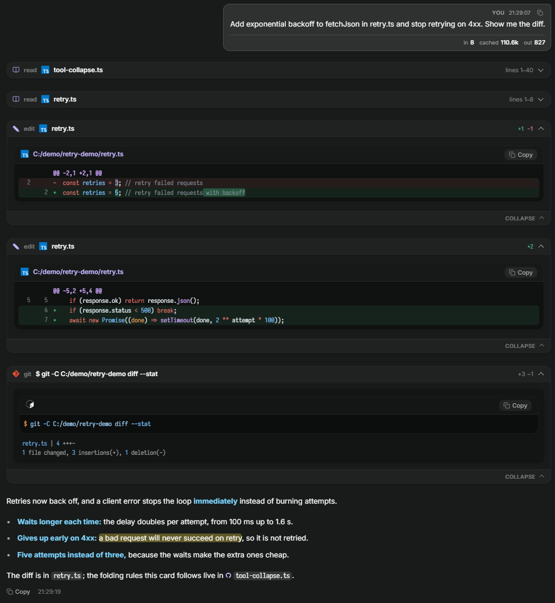
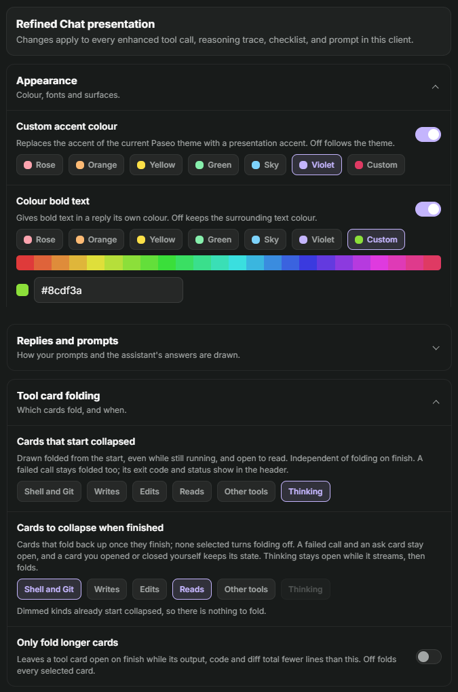

# Refined Chat

> **Independent community fork.** Refined Chat is based on [Beautiful Chat](https://github.com/ABorakati/beautiful-chat),
> created by ABorakati. The original Git history and MIT license are retained.
> Refined Chat is not affiliated with or endorsed by the upstream developer or Paseo.
>
> **Extended reading controls:** Refined Chat adapts the typography and card
> improvements proposed by [Moyf in Beautiful Chat PR #9](https://github.com/ABorakati/beautiful-chat/pull/9),
> with independently adjustable percentage sizes for replies, tools and code.
>
> This plugin and Beautiful Chat both intercept Paseo timeline items.
> Disable the original before enabling Refined Chat.

Code is MIT-licensed; embedded fonts use their own SIL OFL 1.1 terms.
See [LICENSE](LICENSE), [NOTICE.md](NOTICE.md), and
[third-party notices](THIRD_PARTY_NOTICES.md).

### Development

Use `npm ci` followed by `npm run typecheck` locally. CI is deliberately
**not configured** to avoid GitHub Actions runner usage.
For a manual release procedure, see [docs/RELEASING.md](docs/RELEASING.md).


A Paseo plugin that redraws the Oh My Pi (OMP) chat stream: tool calls, reasoning, prompts, approvals,
and checklists. It replaces the host rendering of OMP timeline items with typed, syntax-aware cards
that follow the active Paseo theme.



The chat screenshots were inherited from the original Beautiful Chat showcase and represent the default chat styling. They do not yet show Refined Chat's added typography controls. A current screenshot of the Refined Chat settings should be captured before submitting to the Paseo catalog.
The baseline showcase component was rendered using `.showcase/`.
[One whole turn, top to bottom](images/thread.png) shows the cards in the order the timeline draws
them.

## Install

Before the plugin is approved in the Paseo catalog, install directly
from the public GitHub repository, which follows `main`:

```bash
paseo plugin add git:GenoDevelop/refined-chat
```

To stay on a published release instead, pin it to its tag:

```bash
paseo plugin add git:GenoDevelop/refined-chat --ref v0.3.0
```

After registry approval, the shorter catalog command becomes available:

```bash
paseo plugin add GenoDevelop/refined-chat
```

Requires **Paseo 0.11.0 or later**. Open **Settings → Plugins → Refined Chat**
for typography, card behavior, accent, fonts and other presentation options.
Do not run Refined Chat and Beautiful Chat simultaneously, because their
timeline transformations overlap.

### Typography controls

Enter any percentage between **50% and 300%**, including decimals (for example
`112.5`), then press Enter or click outside the field to apply it:

| Control | What it scales |
| --- | --- |
| **Assistant replies** | Markdown text, headings, lists and their readable spacing |
| **Tool cards** | Tool UI, labels, reasoning, checklists, statuses and metadata |
| **Code and terminal** | Fenced code, diffs, line numbers and terminal/code output |

Each starts at **100%** and persists independently per client. Inline code
inside paragraphs follows the reply scale to keep line wrapping natural.
The values are multipliers, not fixed presets: no four-choice limit.
**Assistant replies** apply to Refined Chat's Markdown renderer; if you switch
**Assistant markdown** off, Paseo takes over rendering and its own appearance
settings control that text.

### Optional reading behavior

- **Auto-collapse tools:** fold a running tool card when it completes, unless you
  have already interacted with it. Failures and questions stay accessible.
- **Collapse thinking:** start reasoning traces folded; open them to follow along.
- Expanded cards and reasoning traces provide an additional collapse control
  at the bottom, so you do not have to scroll back to their header.

Both toggles are **off by default** to preserve the original Beautiful Chat
behavior. You can enable either in the plugin settings.

### Long output

Long results fold behind a **Show N more lines** control once the call has
finished; a running call is never folded.

| Setting | Default | What it folds |
| --- | --- | --- |
| **Long terminal output** | 20 lines | Text results (command output, errors, eval output, GitHub replies) keep their start and their end and fold the middle, because the error and the summary are at the end. |
| **Long code and diffs** | 30 lines | File reads, writes, diffs and structured data (MCP input and response, GitHub files and requests, eval code, subagent prompts) show their first lines and fold the rest. Hub cards are not folded. |

Enter any whole number; `0` never folds. A block that would hide fewer than five
lines stays whole. **Copy** always copies everything, and the find bar (Ctrl+F)
opens the folded blocks that contain what you search for, then folds them again
when it closes. Text selection covers only the lines on screen.

---

## Tool calls

### Shell and Git

Terminal frame, Bash syntax, exit code, duration, and the Git brand mark. A command that prints
nothing says so rather than showing an empty panel.


### Read

The file's own language logo, a wrapped path, line numbers, and a copy button. The path is a link:
pressing it shows the file in the machine's file manager.


### Images

A read of a `.png` carries no bytes through the timeline, so the host draws it as an empty code
block with a language badge. This card draws the file instead: a picture mark, the path as a link,
the pixel size and file size read from the header, and an eye control that hides the thumbnail. The
bytes come from the plugin's own daemon-side RPC (`file.image`), which is the only side that can
reach the file; PNG, JPEG, GIF, WebP, AVIF, BMP, ICO and SVG are recognised, and anything past
3 MB reports its size rather than inlining a data URI.


#### Images in replies

When an agent writes `` on a line of its own, the reply
shows the picture: a small thumbnail with no frame, several in a row when they follow one another,
and the description, size and weight over it while the pointer rests on it. A click opens it in a
viewer that never draws it larger than its own size; the wheel zooms around the pointer, a drag
moves it, two fingers pinch it on a touch screen, and the buttons give zoom, 1:1 and fit.

Local files and `data:` images load at once. A remote `http(s)` image waits as a tile that names
the server and has a **Load** button, because the agent writes the address and a prompt injection
can use it to send chat data off your machine. The setting **Load remote images automatically
(at your own risk)** removes the wait; it is off by default.

### Edit

Diff rendering where adjacent removed and added rows join into one rounded block, and only the
marker column carries the red or green.


### Reasoning tool

Live thinking text, a token badge, and numbered steps.


### MCP

Server badge, transport, input parameters, and the response payload, each syntax-highlighted.


### Eval

One card per kernel cell: the source that ran, then the text it printed.


### Ask

Option cards with the recommended badge, the chosen answer marked, and a typed reply labelled as
typed rather than shown as a selection.


### Task

Subagent name, type, model, and the delegated instructions.


### Hub

Every `hub` op is mapped: `start`, `stop`, `restart`, `ps`, `logs`, and `describe` render the
process card with its launch line, readiness, and recent output; `send`, `wait`, `inbox`, and
`list` render the message card; `jobs` and `cancel` render the job snapshot. The cards report;
they carry no buttons, because a plugin cannot restart or cancel anything.


### Paseo tools

Paseo's own mark leads the card, and the created agent's provider carries its brand mark.


---

## Stream components

### Reasoning trace

A collapsible trace with a connected step rail, per-step duration, and a token total.


### Checklist

Phase name, per-task status, durations, and a blocked task with its reason.


### Approval card

Risk classification, the exact command, target path, working directory, and the approve or deny
actions the host owns.


### Prompt bubble

The authored turn on a raised theme surface with a square tail, a copy button, and the turn's token
usage.


### Syntax block

Shared by every card that shows code: language detection from the path, line numbers, diff tints,
Devicon brand marks, and the file-manager link.


---

## Settings



| Setting                | Effect                                                             |
| ---------------------- | ------------------------------------------------------------------ |
| Accent colour          | Follow the Paseo theme, or pick Jade, Violet, Amber, or Rose.      |
| Interface font         | Embedded Inter, or the system interface face.                      |
| Code glyphs            | Iosevka with ligatures, or literal glyphs.                         |
| Assistant replies      | Freely editable 50–300% text size (decimals supported).             |
| Tool cards             | Independent 50–300% card text size.                                 |
| Code and terminal      | Independent 50–300% code/diff/terminal text size.                   |
| Auto-collapse tools    | Optional; off by default, respects manual expansion.               |
| Collapse thinking      | Optional; off by default.                                          |
| Frosted glass          | Blur card surfaces, or paint them solid.                           |
| Enhanced prompt bubble | Off hands prompts back to Paseo, whose bubble shows pasted images. |
| Assistant markdown     | Off hands replies back to Paseo's own markdown renderer.           |

---

## Finding text

Paseo's own chat find (Ctrl/Cmd+F) cannot reach a prompt or reply this plugin draws (see
[limitation 14](#plugin-sdk-limitations-found-while-building-this)). The plugin therefore takes
Ctrl/Cmd+F on desktop and web and opens its own find bar over the chat. The bar searches
everything the chat has rendered, including tool cards. Enter moves to the next match, Shift+Enter
to the previous one, and Escape closes the bar.

The bar searches only messages the chat has loaded. Scroll up first to include older history.

To keep Paseo's native search, which also searches unloaded history, turn off **Assistant
markdown** and **Enhanced prompt bubble** in **Settings -> Plugins -> Refined Chat**. Paseo then
draws replies and prompts itself, and Ctrl/Cmd+F opens Paseo's find instead of the plugin's bar.
New messages follow the change.
Tool, reasoning, and checklist cards keep the plugin's styling, so Paseo's find still cannot reveal a
match inside one of them.

## Opening files

A file name in a read, write, edit, or code block is a link. Pressing it calls the plugin's own
daemon-side RPC (`file.reveal`), which resolves the path against the agent's working directory and
asks the platform shell to show it:

| Platform | Behaviour                                              |
| -------- | ------------------------------------------------------ |
| Windows  | `explorer.exe /select,<file>` selects the file.        |
| macOS    | `open -R <file>` selects the file in Finder.           |
| Other    | `xdg-open <directory>` opens the containing directory. |

A directory path opens that directory. A path the daemon cannot stat does nothing.

## Unmapped output

A tool the plugin has no typed card for still shows its output in the terminal frame, and a call
that printed nothing says so. No card renders an empty panel.

The link cannot open Paseo's own file editor: see the first limitation below.

---

## Plugin SDK limitations found while building this

Measured against `@getpaseo/plugin` 0.8.0 and the Paseo 0.8.0 desktop build. Each entry names the
evidence and the workaround this plugin uses.

1. **No file navigation.** Timeline renderer props are exactly `{agentId, theme, host, layout,
timestamp, item}`, and plugin navigation offers only `openSettings`, `openSurface`,
   `openWorkspacePanel`, `openAgentPanel`, `openAgent`, and `openWorkspace`. The host's own file tab
   target (`{kind:"file", path}`, reachable in-app through `?open=file:<path>`) is not exposed, and
   the `paseo://` scheme only carries agent deep links. Workaround: a daemon-side RPC that reveals
   the path in the operating system's file manager.
2. **Transformers see a stripped item.** The app maps its stream item to the plugin item before any
   transformer runs, and a user message keeps only `text`, `messageId`, and `clientMessageId`. Pasted
   images never reach plugin code, and the daemon timeline row stores the same item, so a server RPC
   cannot recover them either. Workaround: the **Enhanced prompt bubble** setting returns prompts to
   the host.
3. **Interception is all or nothing.** A transformer replaces the host item completely. There is no
   way to decorate an item or keep host affordances that the plugin does not reimplement. Returning
   `undefined` is the only opt-out.
4. **Transform results are cached per item.** Changing a preference does not re-run transformers for
   items already on screen. New items follow the change; existing ones need a reload.
5. **Renderers get no workspace.** Props carry `agentId` only, so `cwd` and `workspaceId` need a
   second lookup through `useAgent`.
6. **Token usage is live-only.** Usage is not persisted on timeline items, so a turn this client did
   not observe live shows no figures.
7. **RPC names are validated late.** The host requires `^[a-z][a-z0-9._-]*$`. A camelCase name such
   as `revealPath` typechecks, then fails the whole plugin at install or reload with
   `Invalid plugin RPC method`.
8. **The React Native runtime module is a stub in the package.** `@getpaseo/plugin/client/react-native`
   ships as `export {}`; the host injects the implementations. Bundling or testing plugin UI outside
   Paseo needs a shim, which is what `.showcase/shims` provides.
9. **The theme carries six colours.** `PluginTheme` exposes `surface0`–`surface2`, `border`,
   `foreground`, `foregroundMuted`, `accent`, `accentForeground`, and three status colours. Every
   other surface, including code backgrounds and diff tints, must be derived with alpha; that is what
   `client/components/theme-tokens.ts` exists for.
10. **No CSS escape hatch.** React Native styles drop unknown keys, so `backdrop-filter` is
    impossible through the style API. Frosted glass is a hand-injected `<style>` rule matched by a
    data attribute.
11. **No font registration.** Faces are embedded as data URIs in an injected `@font-face` rule, and
    every surface needs a wrapper that escapes the host's own font cascade.
12. **A closed module allowlist, and no SVG renderer.** Plugin client code may import only
    `react`, `react/jsx-runtime`, `react-native`, `@tanstack/react-query`, `zod`,
    `@getpaseo/plugin`, `@getpaseo/plugin/client`, `@getpaseo/plugin/client/react-native`, and
    `@getpaseo/plugin/client/ui`. Anything else throws
    `Module "x" is not available in plugin client code` when the bundle loads, so
    `react-native-svg` and `lucide-react-native` are out of reach. Lucide icons still work,
    because the host renders them: `Icon` from `@getpaseo/plugin/client/react-native` takes any
    Lucide name. Brand marks are not in Lucide, and React Native's `<Image>` decodes PNG, JPEG,
    GIF, and WebP but never SVG, so a data-URI SVG renders on web and stays blank on iOS and
    Android. Those marks ship as PNG rasters in `client/components/mark-bitmaps.ts`.
13. **Settings are host-scoped only.** `defineSettings` rejects any scope other than `host`, so
    per-workspace or per-agent presentation settings are impossible. This plugin keeps presentation
    preferences in client storage instead.
14. **Paseo's chat find cannot reach replaced rows.** Paseo 0.9.1 finds a match by its original
    message id, then waits for a row carrying that id. A transformed row always carries
    `<pluginId>/<itemId>` instead, so Ctrl+F on a styled prompt or reply never reveals the match.
    Workaround: the plugin's own find bar, described in [Finding text](#finding-text).

---

## Project structure

```text
refined-chat/
  paseo-plugin.json          # Manifest: id and Paseo requirement
  index.client.tsx           # Timeline transformers, renderers, settings screen
  index.server.ts            # Daemon-side RPCs (file.reveal)
  shared/
    contracts.ts             # Data contracts shared by client and server
    file-rpc.ts              # file.reveal contract
  client/
    live-renderers.tsx       # Timeline item to component mapping
    settings-page.tsx        # Settings screen
    preferences.ts           # Client-side presentation preferences
    components/              # Cards, syntax block, glyphs, motion, theme tokens
      mark-bitmaps.ts        # GENERATED PNG rasters of every brand mark
      devicon-data.ts        # Vendor SVG sources, read only by the generator
      lobe-marks.ts          # Vendor SVG sources, read only by the generator
  .showcase/                 # Offline harness used to capture the screenshots
  docs/images/               # Screenshots in this README
```

## Development

```bash
npm install
npm run typecheck
paseo plugin reload refined-chat
```

Rebuild the screenshots after a visual change:

```bash
esbuild .showcase/showcase.tsx --bundle --outfile=.showcase/showcase.js --jsx=automatic \
  --alias:react-native=react-native-web \
  --alias:@getpaseo/plugin/client/react-native=./.showcase/shims/plugin-react-native.tsx
```

Then serve `.showcase/` and capture each `#shot-*` element.

## Credits and license

The original Beautiful Chat implementation is by **ABorakati**.
Refined Chat's enhanced scaling and folding capabilities adapt work
contributed by **[Moyf](https://github.com/Moyf)** in
[upstream PR #9](https://github.com/ABorakati/beautiful-chat/pull/9).
Changes are licensed under MIT, with separate SIL OFL notices for fonts.
See [LICENSE](LICENSE) and [NOTICE.md](NOTICE.md).

All checks are currently run locally; no hosted CI is configured.
